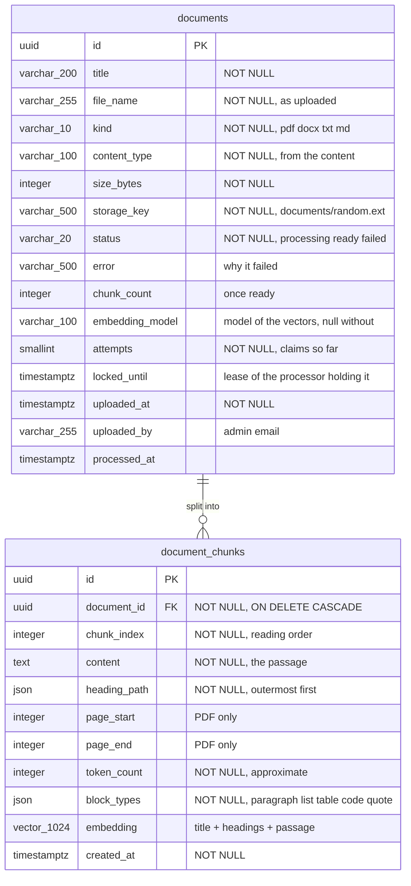

# Database schema

Created by migration `0001_cms`
([migrations/versions/20261020_0001_create_cms_tables.py](../migrations/versions/20261020_0001_create_cms_tables.py)).

The tables are independent: content is addressed by path or name, and "who changed it" is kept
as the admin's email, so removing an admin account never touches content.

```mermaid
erDiagram
    admin_users {
        uuid id PK
        varchar_255 email UK "NOT NULL, lower case"
        varchar_255 password_hash "NOT NULL, werkzeug scrypt"
        boolean is_active "NOT NULL"
        integer session_version "NOT NULL, in every token"
        timestamptz last_login_at
        timestamptz created_at "NOT NULL"
        timestamptz updated_at "NOT NULL"
    }

    admin_login_failures {
        uuid id PK
        varchar_300 key "NOT NULL, ip:<addr> or user:<email>"
        timestamptz failed_at "NOT NULL"
    }

    site_settings {
        varchar_30 section PK "CHECK in 8 sections"
        jsonb value "NOT NULL, the whole section"
        timestamptz updated_at "NOT NULL"
        varchar_255 updated_by "NOT NULL, admin email"
    }

    pages {
        uuid id PK
        varchar_200 path UK "NOT NULL, / or /lower-case-words"
        varchar_120 title "NOT NULL"
        varchar_120 heading "NOT NULL, empty hides it"
        varchar_300 description "NOT NULL"
        varchar_10 lang "NOT NULL"
        boolean slideshow "NOT NULL"
        varchar_10 sidebar "NOT NULL, CHECK home or banners"
        boolean tools "NOT NULL"
        varchar_120 parent_title
        varchar_500 parent_to
        integer sort_order "NOT NULL, site-map order"
        boolean published "NOT NULL"
        text body "NOT NULL, Markdown"
        varchar_200 shipped_path UK "seed file it came from"
        varchar_255 updated_by "null while as shipped"
        timestamptz created_at "NOT NULL"
        timestamptz updated_at "NOT NULL"
    }

    media_files {
        uuid id PK
        varchar_80 name UK "NOT NULL, public URL-safe name"
        varchar_100 content_type "NOT NULL, from magic bytes"
        integer size_bytes "NOT NULL"
        varchar_500 storage_key "NOT NULL, random S3 / disk key"
        timestamptz uploaded_at "NOT NULL"
        varchar_255 uploaded_by "NOT NULL, admin email"
    }

    contact_messages {
        uuid id PK
        varchar_200 name "NOT NULL"
        varchar_320 email "NOT NULL"
        varchar_300 subject "NOT NULL"
        text message "NOT NULL"
        boolean send_copy "NOT NULL"
        varchar_64 client_ip_hash "HMAC of the IP, for the rate limit"
        timestamptz created_at "NOT NULL"
    }
```

## Notes

- **site_settings** has at most one row per section. No row means the section shows its shipped
  default (`app/seed/site_defaults.py`), so a reset is a delete. `value` is stored with snake_case
  keys (`address_lines`); the API sends camelCase (`addressLines`).
- **pages.updated_by** is null while a page is exactly as shipped; any admin change sets it, and a
  reset clears it again. `flask seed-content` only updates pages where it is null (unless `--force`).
- **pages.shipped_path** links a page to `app/seed/pages/<name>.md` even after an admin changes
  its path, so it can still be reset and re-seeding doesn't create a duplicate. It is null for pages
  admins created.
- **pages.sort_order** is `order` on the wire (`order` is a reserved word in SQL).
- **admin_users.session_version** is part of every access token. Bumping it (sign-out, password
  change, deactivation) makes all of that admin's tokens invalid at once.
- **admin_login_failures** rows older than `ADMIN_LOCKOUT_MINUTES` no longer count and are deleted
  when the same key fails again. A successful sign-in deletes the account's rows, not the IP's.
- **contact_messages.client_ip_hash** is `HMAC-SHA256(SECRET_KEY, ip)`: enough to count a
  visitor's messages in the last hour, without storing their address.

## Indexes

| Index | For |
| --- | --- |
| `uq_pages_path`, `uq_pages_shipped_path` | Page lookup by path; one page per shipped file |
| `uq_media_files_name` | Public file lookup |
| `uq_admin_users_email` | Sign-in |
| `ix_admin_login_failures_key_failed_at` | Lockout count per key within the window |
| `ix_contact_messages_created_at` | Admin inbox, newest first |
| `ix_contact_messages_client_ip_hash_created_at` | Contact-form rate limit |

## Documents for the AI assistant

Created by migration `0002_documents`
([migrations/versions/20261020_0002_create_documents.py](../migrations/versions/20261020_0002_create_documents.py)),
which enables the **pgvector** extension on PostgreSQL.

- **documents is also the processing queue.** `status = 'processing'` with no lease, or a lease in
  the past, is waiting. A processor claims one with a single conditional `UPDATE` (sets
  `locked_until`, adds 1 to `attempts`), so concurrent workers never take the same document.
- **Deleting** a document deletes its chunks in bulk first; the foreign key cascades as a
  backstop. A processor writes its chunks only after `SELECT … FOR UPDATE` on the document, so a
  delete that came first leaves it nothing to write to.
- **embedding** is `vector(1024)` on PostgreSQL (JSON on SQLite, for tests). Changing the
  dimension needs a migration and `flask documents reprocess --all`.

| Index | For |
| --- | --- |
| `ix_documents_status_locked_until` | Finding the next waiting document |
| `uq_document_chunks_document_chunk` | One passage per position in a document |
| `ix_document_chunks_embedding` | HNSW, `vector_cosine_ops`: nearest passages by vector (PostgreSQL) |
| `ix_document_chunks_content_fts` | GIN on `to_tsvector('simple', content)`: keyword search (PostgreSQL) |
